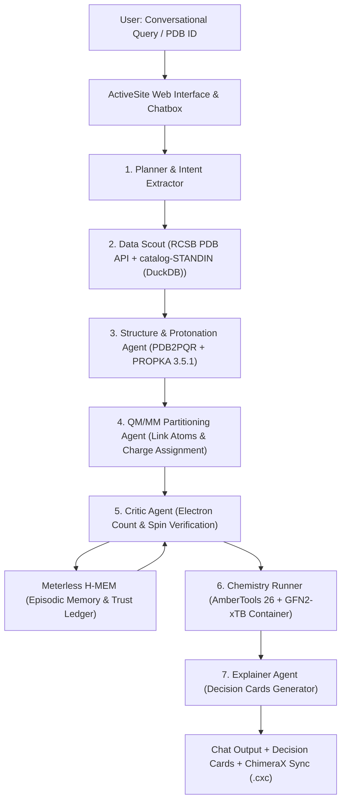

# ActiveSite 🔬🤖
### Autonomous QM/MM Simulations with Explainable Scientific Reasoning
**Open Agent Hackathon 2026 | Track 02: "The Agent That Can Explain Why"**

[](https://hackathons.genai.works)
[](https://hackathons.genai.works)
[](https://ambermd.org)
[](https://meterless.io)
[-blueviolet)](https://zetaris.com)

---

## 🌟 Overview
Quantum Mechanics / Molecular Mechanics (QM/MM) is the gold standard for modeling enzyme catalysis, scissile bond cleavages, and covalent drug binding. However, setting up a QM/MM calculation traditionally requires days of manual labor:
1. Identifying catalytic residues and setting cutoff radii.
2. Determining correct protonation states ($pK_a$) and formal charges.
3. Placing covalent link atoms along peptide bonds without orbital distortion.
4. Diagnosing mysterious SCF convergence or odd-electron spin failures.

**ActiveSite** transforms this workflow into a single conversational request:
> *"Set up a QM/MM simulation of EGFR kinase with erlotinib (PDB 1M17) at pH 7.4."*

ActiveSite autonomously retrieves the structure from RCSB PDB, calculates protonation states via PROPKA, partitions the active site, verifies quantum charge balance, writes Amber QM/MM input, and generates **Decision Cards** explaining every choice.

> **Status (P0, 2026-10-22):** the Docker chemistry engine is not implemented yet. Every report and API response carries `energy = null` with the message `engine not implemented yet`. No energy is ever synthesized.

---

## 🧠 Why Track 02: "The Agent That Can Explain Why"
In scientific simulations, a "black-box" agent is dangerous. ActiveSite does not simply execute commands; it explains its scientific justification at every decision point:

* **Why did the agent choose Met769 and Thr766 in the QM region?**
  * *Explanation:* Hydrogen-bonding distances to the quinazoline nitrogen (2.8 Å) require explicit electronic polarization; peripheral hydrophobic residues outside 4.0 Å are safely relegated to the classical MM force field.
* **Why did the agent change `qmcharge` from 0 to +1 in I-PpoI endonuclease?**
  * *Explanation:* Diagnosed an odd-electron open-shell failure. His98 coordination to the catalytic $Mg^{2+}$ ion shifts its charge balance, resolved via Meterless H-MEM episodic memory.

---

## 🏗️ Architecture



---

## 🤝 Sponsor Integrations
* **Meterless H-MEM:** Powers the agent's episodic memory and Trust Ledger. Remembers ligand parameter overrides, active site boundaries, and prior error resolutions to prevent repeated mistakes across simulation sessions.
* **Zetaris:** Target federated data harness. Today the MCP catalog tools are served by **catalog-STANDIN (DuckDB)**, a local stand-in over the benchmark cases; it is swapped for a real Zetaris connection once `ZETARIS_REST_URL` and `ZETARIS_API_KEY` are set.
* **Cursor:** Primary IDE used to build, orchestrate, and audit agent workflows, governed by project `.cursorrules`.

---

## ⚡ Quickstart (Judge Friendly)

ActiveSite is packaged with a single-command startup and a CPU-friendly `SAMPLE_MODE=true` offline mode. No external API keys or GPU required to evaluate. Copy `.env.example` to `.env` to configure optional services.

### 1. Prerequisites
- Docker & Docker Compose (or Colima on macOS)
- Python 3.11+ (with `uv` recommended)
- [Optional] UCSF ChimeraX for 3D visual inspections

### 2. Launch Services
```bash
# Clone the repository
git clone https://github.com/KhangLuong314/ActiveSite-QM-MM.git
cd ActiveSite-QM-MM

# Start database and local services
docker compose up -d

# Install Python dependencies
uv sync

# Launch the ActiveSite interactive server
uv run python -m activesite.server.main
```
Open **`http://localhost:8088`** in your browser.

---

## 📂 Project Structure
```text
ActiveSite-QM-MM/
├── .cursor/                 # Cursor IDE rules & MCP configurations
├── docs/
│   └── prompts/
│       └── PROMPT_LOG.md    # Transparent audit trail of prompt engineering
├── docker/
│   ├── engine.Dockerfile    # AmberTools 26 + GFN2-xTB runtime
│   └── prep.Dockerfile      # PDB2PQR, PROPKA 3.5.1, RDKit environment
├── activesite/
│   ├── agent/               # Autonomous agent orchestration (Planner, Critic, Explainer)
│   ├── adapters/            # RCSB PDB & catalog-STANDIN (DuckDB) MCP connector
│   ├── memory/              # Meterless H-MEM episodic memory client
│   ├── chemistry/           # Amber/xtb execution, link atoms, QM partitioning
│   ├── visualizer/          # ChimeraX .cxc script generator
│   └── server/              # FastAPI application with SSE chat streaming
├── ui/                      # Browser UI (Chatbox + Decision Cards + 3D View)
├── docker-compose.yml       # Local Postgres & MinIO infrastructure
└── pyproject.toml           # Project dependencies & package metadata
```

---

## 👥 Authors & Team
- **Khang Luong** ([@KhangLuong314](https://github.com/KhangLuong314)) — University of Nebraska–Lincoln
