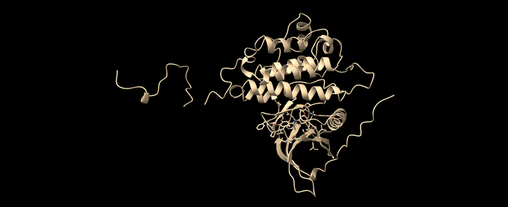
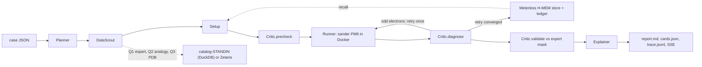

# ActiveSite 🔬🤖
### Autonomous QM/MM Assistant that explains every choice
**Open Agent Hackathon 2026 | Track 02: "The Agent That Can Explain Why"**

[](https://hackathons.genai.works)
[](https://hackathons.genai.works)
[](https://ambermd.org)
[](https://build.nvidia.com)
[](https://meterless.io)
[_%2F_Zetaris-blueviolet)](https://zetaris.com)
[-cyan)](https://ambermd.org)

<p align="center">
  
  <br>
  <em>1,000-step (1 ps) autonomous QM/MM MD trajectory of EGFR kinase with erlotinib (PDB 1M17). ActiveSite monitors hinge stability (:LIG@N2 to Met769:H locked at 2.45 ± 0.29 Å) and generates 1-click ChimeraX playback scripts.</em>
</p>

## What it does
1. Takes a benchmark case (a Mg-dependent phosphodiester site or a protein-ligand complex) and proposes a QM region from geometry, with the distance, angle and rejected alternative behind every residue.
2. Runs one PM6 QM/MM single point or 1 ps (1,000 steps, 100 frames) Molecular Dynamics simulation in `sander` inside a Docker container, never on the host.
3. Lets a Critic diagnose an odd-electron failure, retry once with the MM partial-charge integer, and store that rule in Meterless H-MEM so the next site starts warm.
4. Explains the run as **15 numbered Decision Cards** with evidence, source and a confidence computed from a measured margin, streamed live to an interactive dashboard.
5. Never shows a number an engine did not produce: a missing energy is `null` with the reason, and sample mode replays real cached outputs labelled as such.

## Track 02 "Why": Auditable Decision Cards & Episodic Learning

### 15 Auditable Decision Cards
Every autonomous choice generates an auditable Track 02 Decision Card (`decision_id`, `choice`, `alternatives`, `rationale`, `confidence`, `evidence`):
- **Residue Inclusion (`residue_inclusion`):** Chain choice selected via crystallographic pocket completeness (REMARK 465/470).
- **Protein Protonation (`protonation_state`):** Residues titrated with PDB2PQR + PROPKA 3.5.1 at pH 7.4 with environmental pKa shifts and His tautomer calls (HID vs. HIE).
- **Ligand Neutrality (`protonation_state`):** Explains why erlotinib is neutral (+0): secondary aniline lone-pair delocalization into quinazoline core (pKa < 4.0) and hinge H-bond integrity to Met769.
- **Force Field Parameterization (`theory_selection`):** GAFF2 + AM1-BCC parameterization with net charge sum verified to $\pm 10^{-6}$ e.
- **Frontier Link-Atom Cuts (`link_atom`):** Boundary cuts placed along single non-polar Cα–Cβ σ-bonds with capping hydrogen alignment.
- **Solvent Treatment (`solvent_handling`):** Generalized Born implicit solvent (igb=5, mbondi2) trade-off evaluated against explicit solvent boxes.
- **Critic Precheck & Verification (`critic_correction`):** 5 automated guardrails (ligand charge sum, centroid displacement, steric contacts, total complex charge, minimization gradient GMAX).
- **Literature Binding Mode Validation (`validation`):** Compares computed model contacts to crystal structure (Met769 hinge contact present at 2.90 Å, Thr766 absent due to crystal water removal).
- **Structure Source Audit (`validation`):** Federated SQL query through data layer ranking candidate PDBs by crystallographic resolution.
- **Dynamics Stability (`simulation_dynamics`):** Justifies the 1.0 fs time step (preventing unconstrained X–H vibrational divergence without SHAKE on QM atoms) and 300 K Langevin thermostat coupling.

### Cold vs. Warm Self-Correction (Meterless H-MEM)
The Critic diagnoses parity failures and commits corrective rules to an append-only verifiable trust ledger:

| Phase | Benchmark System | Initial Attempt | Failure Mode & Diagnosis | Critic Action & Ledger Commit | Retries | Final Outcome |
|---|---|---|---|---|---|---|
| **Cold Run** | I-PpoI Site A (`Mg :371`) | Textbook formal charge 0 | Odd valence electrons (203 e⁻), spin=1 mismatch in `sander` | Boundary re-cut to 204 e⁻ (net charge +1); committed `qm-charge` rule to H-MEM ledger | **1 retry** | Converged (ESCF -456.56 kcal/mol) |
| **Warm Run** | I-PpoI Site B (`Mg :372`) | Recalled from H-MEM | None (pre-emptively applied learned charge rule) | Scored memory match from `MemoryRetrievalService`; executed single-pass | **0 retries** | Converged on Attempt 0 |

## Quickstart (judges)
Fastest path, Docker only (no Python setup, no keys):
```bash
docker build -t activesite . && docker run --rm -p 8088:8088 activesite   # dashboard at http://localhost:8088
curl -s -X POST localhost:8088/run -H 'content-type: application/json' -d '{"case_id":"ippoi_site_a"}'
```
The image runs in sample mode: every agent runs for real and the engine step replays recorded real `sander` output,
labelled `cached engine output (sample mode)`. Add `--env-file .env` for live NVIDIA Nemotron; Zetaris is used live only when a Zetaris instance is reachable at `ZETARIS_REST_URL` (otherwise the run uses the labelled DuckDB stand-in and says so).

With Python and `uv` instead:
```bash
docker compose up -d                       # Postgres + MinIO for the DuckDB catalog stand-in (optional)
uv sync
SAMPLE_MODE=true uv run python run.py --case ippoi_site_a      # replays cached engine output, all agents run for real
uv run python run.py --server              # dashboard at http://localhost:8088
```
No API keys, GPU or network are needed in sample mode. Copy `.env.example` to `.env` for optional services.
`scripts/smoke_clean_clone.sh` runs the judged path from a fresh clone and asserts the cached-engine label.

With Docker and the engine images (`docker build -f docker/engine.Dockerfile -t activesite-engine:at26 .` then
`docker build -f docker/prep.Dockerfile -t activesite-prep:at26 .`):
```bash
SAMPLE_MODE=false uv run python run.py --demo-memory --docker   # site A cold (retries 1), site B warm (retries 0)
uv run python run.py --case egfr_erlotinib --docker --md        # 1,000-step QM/MM MD demonstration
uv run python run.py --case egfr_erlotinib --docker --json      # same JSON as POST /run
```

## The three sample cases
| case | what it shows | expected output (sample mode) |
|---|---|---|
| `ippoi_site_a` | cold run: textbook charge 0 fails with an odd electron count, Critic retries at +1, rule stored | `retries 1`, `memory_used False`, a memory written, ESCF from the cached sp.out, engine label `cached engine output (sample mode)` |
| `ippoi_site_b` | warm run: the stored rule is recalled, no retry | `retries 0`, `memory_used True`, 64-67 QM atoms, same label |
| `egfr_erlotinib` | ligand case: chain A, erlotinib kept neutral, GB single point of the whole ligand, MET769 hinge contact recovered, THR766 absent, 1 ps QM/MM MD | `qm_ok True` with the cached preparation, label as above |

Saved inputs live in `samples/<case>/input.json`; the saved outputs (`report.md`, `cards.json`, `trace.jsonl`,
`stats.json`) are produced by `scripts/make_samples.sh` on a Docker host and stamped in `data/sample/MANIFEST.md`.
Those saved reports say `Engine: sander in Docker` because they are the real runs; your own `SAMPLE_MODE=true` run
replays the same engine output and is labelled `cached engine output (sample mode)`.
Until that script has run, sample mode reports `engine unavailable` and shows no energy.

## Your own structure (upload and mutate)
For systems that are not in the case library (a lab mutant, a designed protein, a predicted model), choose
**Your own structure** on the first screen, or use the API:

```bash
curl -F file=@my_protein.pdb -F name="my enzyme" http://localhost:8088/api/structures/upload    # chains, ligands, metals, warnings
curl -H 'Content-Type: application/json' -d '{"mutations":["A:T766M"]}' \
     http://localhost:8088/api/structures/<structure_id>/mutate                               # point mutants
curl -H 'Content-Type: application/json' -d '{"custom":{"structure_id":"<id>","ligand_resname":"AQ4"}}' \
     http://localhost:8088/run
```

- The agents choose the chain, protonation, ligand charge and QM region with a Decision Card for each, plus cards
  for the uploaded file, every mutation and where the ligand SMILES came from (yours, or the RCSB chemical component).
- In sample mode this is a **proposal only**: no energy is computed and every output says so. With Docker
  (`SAMPLE_MODE=false`) the same run prepares, minimises and computes the PM6 QM/MM energy live (about 5 minutes).
- Mutations rebuild the side chain from the Amber residue template; there is no rotamer search or repacking.
- Not supported yet: metal sites from uploaded files (the QM-region rules need an Amber topology), more than one copy
  of the same ligand in a chain, chain ids longer than one character.

## Architecture

- **Agents** (`activesite/agent/core.py`, `ligand.py`): Planner (allow-listed steps), DataScout (validated ids, three SQL queries), Setup / LigandSetup, Runner, Critic / LigandCritic, Explainer. Every action is one line in `logs/trace-<run_id>.jsonl` (`activesite/trace.py`).
- **Loop** (`activesite/agent/orchestrator.py`): `run_case` routes on the case file; the metal loop retries once on an odd-electron failure and remembers only after the retry converged; the ligand loop blocks QM/MM when the ligand left its pocket.
- **Chemistry** (`activesite/chem/`): `system.py` (parmed geometry and charge), `qmregion.py` (evidence-bearing region proposal), `sander.py` (containerised single point & 1 ps QM/MM MD runner, pure mdout parser), `chimerax.py` (3D scene & 100-frame NetCDF trajectory scripts), `prep.py` + `ligand_rdkit.py` (PDB2PQR/PROPKA, GAFF2/AM1-BCC, tleap, minimisation, pose checks).
- **Memory** (`activesite/memory/hmem.py`): SQLite memories with provenance, append-only JSONL ledger, scored retrieval with a hard domain-tag gate; `meterless.py` is the facade, `meterless_mcp.py` the MCP server.
- **Data layer** (`activesite/adapters/`): `zetaris.py` (REST), `catalog_standin.py` (DuckDB over Postgres + MinIO Parquet + cached RCSB), `zetaris_mcp.py` (`list_sources`, read-only `query`); `seed/seed.py` fills the stand-in.
- **Server/UI** (`activesite/server/`): `POST /api/run` + SSE `GET /run/stream`, `POST /run` for judges, `POST /api/chat` (AI Biochemist powered by NVIDIA Nemotron), `POST /api/chimerax/launch` (1-click 3D viewer launch), memory and SQL panels.

## Sponsor technologies
* **Zetaris:** `activesite/adapters/zetaris.py` sends DataScout's SQL to the Zetaris query API (`POST /query/sql/start`, then `/query/sql/page`) when `ZETARIS_REST_URL` and a login (`ZETARIS_USER`/`ZETARIS_PASSWORD`) or `ZETARIS_API_KEY` are set. Verified on 26 Oct 2026 against a local Zetaris platform 2.4.3 (Zetaris Cloud "Run locally"): `smoke_test.py` 3/3 PASS, and an I-PpoI site A run read the lab expert's QM region from `ACTIVESITE.expert_runs` in Zetaris (`catalog: zetaris`, Jaccard 1.0, 64 atoms). Load the tables with `scripts/zetaris/load.sh <zetaris-platform folder>`; details in `docs/ZETARIS_SETUP.md`. If Zetaris is unreachable the run falls back to the labelled stand-in. Otherwise **catalog-STANDIN (DuckDB)** (`activesite/adapters/catalog_standin.py`) federates Postgres (`lab_runs`), MinIO Parquet (`eda_synthetic`, a clearly synthetic placeholder) and a cached RCSB entries table in one DuckDB connection. Seed with `docker compose up -d && uv run python seed/seed.py`. Every DataScout trace line and card source names which adapter ran. MCP: `python -m activesite.adapters.zetaris_mcp`.
* **Meterless H-MEM:** `activesite/memory/hmem.py` implements the Meterless H-MEM engine spec (records with provenance and confidence, append-only ledger with previous state, feedback deltas, superseded penalty, sleep guardrails, conflict gate, dream approval boundary). All 13 Meterless H-MEM conformance vectors (upstream commit 0aa7417, 7 sections) pass under pytest against `activesite/memory/hmem.py`, using the same assertions as the upstream `runner.ts`: `uv run pytest tests/test_hmem_conformance.py`. Not implemented because no vector checks them: entity extraction, embedding similarity (a bag-of-words cosine stands in), domain-reclassification proposals and `relatedTo` discovery. No remote Meterless service is called.
* **NVIDIA:** `activesite/llm.py` talks to `integrate.api.nvidia.com` (OpenAI-compatible) using `nvidia/nemotron-3.5-lightning-30b-a3b` (or `nvidia/llama-3.3-nemotron-super-49b-v1`) only when `MODEL_API_KEY` is set; the Planner allow-lists everything the model returns, and the AI Biochemist chat endpoint contextualizes answers with Decision Cards.
* **Cursor and Claude Code:** the rebuild started in Cursor (`.cursorrules`, `.cursor/mcp.json`) and continued in Claude Code (`CLAUDE.md` imports the same `AGENTS.md` rules; `.mcp.json` mirrors the MCP servers). `docs/prompts/PROMPT_LOG.md` is the prompt audit trail for both.

## Using Meterless Nightshift as the AI provider
[Meterless Nightshift](https://meterless.ai) serves local models through one OpenAI-compatible endpoint, so the chat and Planner can run on your own Mac with no cloud key. No code change is needed; set these in `.env` (or in a copy you export before starting the server):

```bash
MODEL_BASE_URL=http://127.0.0.1:8088/v1          # Nightshift's local /v1 endpoint
MODEL_API_KEY=<your Nightshift Runtime API key>  # Nightshift ▸ Console; unique to each install
MODEL_NAME=webllm/Qwen2.5-3B-Instruct-q4f16_1-MLC
NEMOTRON_MODEL=webllm/Qwen2.5-3B-Instruct-q4f16_1-MLC  # the chat reads this before MODEL_NAME; set both
```

* `GET /v1/models` (with the key as a Bearer token) lists the models your install serves; local models load on first use.
* Nightshift listens on **port 8088 by default**, the same port as the dashboard, so start the dashboard on another port: `uv run python run.py --server --port 8089`.
* Tested on 27 Oct 2026 (Nightshift 0.92.7, Apple M4, 16 GB) with `webllm/Qwen2.5-3B-Instruct-q4f16_1-MLC`: `smoke_test.py` model check PASS, and the dashboard question "Why is the charge +1?" on I-PpoI site A was answered through Nightshift (about 45 s) with 0 unverified numbers from the provenance guard. The answer was only partly right (it named the odd electron count but not the 1.03 partial-charge sum, and wrongly said +1 keeps the system neutral), so the demo uses NVIDIA Nemotron for accuracy. Under memory pressure Nightshift keeps one model loaded; a second model returns "not resident" and the chat falls back to the rule-based answers.

## How the explanations are checked
* **Counterfactuals** (`tests/test_counterfactual_cards.py`): for the QM charge, the Mg first shell, the ligand protonation site, the chain choice and the His override, the test changes one piece of evidence and requires the Decision Card's choice and evidence to change with it.
* **Number provenance** (`activesite/server/provenance.py`, `tests/test_chat_provenance.py`): every energy or distance in a chat reply must come from the active run's stats, cards or report, or be a fixed method setting; anything else is marked `⚠ not from a run`. Every preset question in the UI returns zero unverified numbers. Systems with no case file (EcoRV, TEM-1) get an answer that they are unsupported, with no numbers.

## Models and frameworks
PM6 (AmberTools 26 `sander`, `activesite-engine:at26`); ff14SB + GAFF2/AM1-BCC; PDB2PQR + PROPKA 3.5.1; RDKit (in `activesite-prep:at26`).
Optional LLM: `nvidia/llama-3.3-nemotron-super-49b-v1` / `nvidia/nemotron-3.5-lightning-30b-a3b`. Python: FastAPI, pydantic, parmed, numpy, pandas, duckdb, httpx, psycopg2. See `metadata.json`.

## Limitations
- PM6 semi-empirical single points and 1 ps (1,000-step, 100-frame) Langevin QM/MM MD; higher-level DFT (B3LYP) is available in reference protocols but not executed locally in the quick judge path.
- Implicit solvent (igb=5) for ligand cases; crystal waters, including the Thr766 bridge in 1M17, are removed.
- No free-energy barriers are computed locally; the lab's QMHub/B3LYP protocol is cited, not reproduced.
- The data catalog is a local stand-in (`catalog-STANDIN (DuckDB)`) until Zetaris credentials are configured; the EDA table it serves is synthetic.
- His states near a ligand cation are geometric calls within a 1 pKa window; the charged state should be run as a sensitivity check.
- The Critic's electron count on the metal case comes from the MM partial-charge sum of the cut region, validated by sander's own parity check, not from an independent electronic-structure count.
- Sample mode replays outputs recorded on a Docker host; without that cache it reports `engine unavailable`.
- Ligand protonation is inferred only for tertiary amines that H-bond a backbone C=O; amidines, guanidines, carboxylates and metal-bound ligands are not handled.
- Without `MODEL_API_KEY` the chat uses rule-based answers (labelled `rule_based_fallback`); they explain concepts and the recorded run but cannot answer open questions.
- Minimisation is not bit-reproducible across runs: a live EGFR re-run on 27 Oct gave ESCF -8.2817 kcal/mol (the built-in case and the same structure uploaded as a user file agree), while the recorded sample run, which sample mode replays, gave -8.2856. Treat the last two digits as run-to-run noise.
- No ABL run is recorded in `samples/`, so in sample mode the chat says no ABL run exists until one is run on a Docker host.

## Pre-existing components and data
Declared in full in [`docs/PRE_EXISTING.md`](docs/PRE_EXISTING.md). In short:
- **Lab reference files under `data/reference/`** (existed before the build window): `qmmm_dft/step3_pbcsetup.parm7` and `prod00.ncrst` (solvated I-PpoI/DNA topology and production frame), `qmhub.ini` and its legacy copy, the `step5.00/step6.00` mdin templates, the `gen_inputs.sh` / `gen_qmmask.py` / `gen_cvs.py` / `gen_cv.sh` / `cv.rst` setup scripts, `abl/2hyy.pdb` and `egfr/1m17.pdb` (RCSB entries), `abl/abl_ligand.yaml` + `abl_ligand_model_0.cif`, `eda/barrier_res_table.pkl` (never loaded), `fmatch/energy.npy`, `mm_charge.npy`, `list.dft_forces`, `list.model`, `wtp/theories.csv`.
- **Chemistry spike benchmark:** none of its files are included.
- **Docker base images:** `mambaorg/micromamba:1.5.10` with conda-forge `ambertools=26.0`, `xtb=6.7.1`, `rdkit=2026.03.1`, `pdb2pqr=3.6.1`, `propka=3.5.1`; `postgres:16-alpine`; `bitnamilegacy/minio:2025.4.22`.
- **Pre-window scaffold (2026-10-21):** first-pass modules whose fabricated energies, seeded memories and radius pipeline were removed during the window (see `PROMPT_LOG.md` P0 and P7).
The large reference files (`*.parm7`, `*.ncrst`, `fmatch/*.npy`, `eda/*.pkl`, about 21 MB) ship in the repo as ordinary git objects: no Git LFS, no download step. `data/reference/LARGE_FILES.sha256` lists their hashes and `scripts/fetch_reference.sh` is an optional path for refreshing them from a mirror; a clean clone never needs it.

## Project structure
```text
activesite/        agent/ (core, ligand, orchestrator)  chem/ (system, qmregion, sander, prep)  memory/ (hmem, meterless)  adapters/  server/  llm.py  trace.py  sample.py
cases/             benchmark case definitions
data/reference/    lab reference files (declared above)      data/sample/   cached engine outputs (make_samples.sh)
samples/           judged inputs and saved outputs            seed/          catalog seed script
scripts/           make_samples.sh, smoke_clean_clone.sh, fetch_reference.sh
docs/              PROMPT_LOG.md, PRE_EXISTING.md             tests/         pytest suite (Docker tests skip themselves)
```

## Authors
- **Khang Luong** ([@KhangLuong314](https://github.com/KhangLuong314)) — University of Nebraska–Lincoln
- **Mohanendra Siddha** ([@mohanendrasidda](https://github.com/mohanendrasidda)) — University of Nebraska–Lincoln
