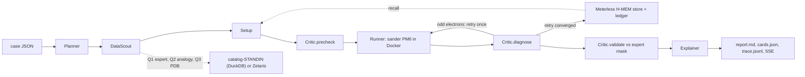

# ActiveSite 🔬🤖
### Autonomous QM/MM setup that explains every choice
**Open Agent Hackathon 2026 | Track 02: "The Agent That Can Explain Why"**

[](https://hackathons.genai.works)
[](https://hackathons.genai.works)
[](https://ambermd.org)
[](https://meterless.io)
[-blueviolet)](https://zetaris.com)

## What it does
1. Takes a benchmark case (a Mg-dependent phosphodiester site or a protein-ligand complex) and proposes a QM region from geometry, with the distance, angle and rejected alternative behind every residue.
2. Runs one PM6 QM/MM single point in `sander` inside a Docker container, never on the host.
3. Lets a Critic diagnose an odd-electron failure, retry once with the MM partial-charge integer, and store that rule in Meterless H-MEM so the next site starts warm.
4. Explains the run as numbered Decision Cards with evidence, source and a confidence computed from a measured margin, streamed live to a dashboard.
5. Never shows a number an engine did not produce: a missing energy is `null` with the reason, and sample mode replays real cached outputs labelled as such.

## Quickstart (judges)
```bash
docker compose up -d                       # Postgres + MinIO for the DuckDB catalog stand-in (optional)
uv sync
SAMPLE_MODE=true uv run python run.py --case ippoi_site_a      # replays cached engine output, all agents run for real
uv run python run.py --server              # dashboard at http://localhost:8088
```
No API keys, GPU or network are needed in sample mode. Copy `.env.example` to `.env` for optional services.
`scripts/smoke_clean_clone.sh` runs the judged path from a fresh clone and asserts the cached-engine label.

With Docker and the engine images (`docker build -f docker/engine.Dockerfile -t activesite-engine:at26 .` then
`docker build -f docker/prep.Dockerfile -t activesite-prep:at26 .`):
```bash
SAMPLE_MODE=false uv run python run.py --demo-memory --docker   # site A cold (retries 1), site B warm (retries 0)
uv run python run.py --case egfr_erlotinib --docker --json      # same JSON as POST /run
```

## The three sample cases
| case | what it shows | expected output (sample mode) |
|---|---|---|
| `ippoi_site_a` | cold run: textbook charge 0 fails with an odd electron count, Critic retries at +1, rule stored | `retries 1`, `memory_used False`, a memory written, ESCF from the cached sp.out, engine label `cached engine output (sample mode)` |
| `ippoi_site_b` | warm run: the stored rule is recalled, no retry | `retries 0`, `memory_used True`, 64-67 QM atoms, same label |
| `egfr_erlotinib` | ligand case: chain A, erlotinib kept neutral, GB single point of the whole ligand, MET769 hinge contact recovered, THR766 absent | `qm_ok True` with the cached preparation, label as above |

Saved inputs live in `samples/<case>/input.json`; the saved outputs (`report.md`, `cards.json`, `trace.jsonl`,
`stats.json`) are produced by `scripts/make_samples.sh` on a Docker host and stamped in `data/sample/MANIFEST.md`.
Until that script has run, sample mode reports `engine unavailable` and shows no energy.

## Architecture

- **Agents** (`activesite/agent/core.py`, `ligand.py`): Planner (allow-listed steps), DataScout (validated ids, three SQL queries), Setup / LigandSetup, Runner, Critic / LigandCritic, Explainer. Every action is one line in `logs/trace-<run_id>.jsonl` (`activesite/trace.py`).
- **Loop** (`activesite/agent/orchestrator.py`): `run_case` routes on the case file; the metal loop retries once on an odd-electron failure and remembers only after the retry converged; the ligand loop blocks QM/MM when the ligand left its pocket.
- **Chemistry** (`activesite/chem/`): `system.py` (parmed geometry and charge), `qmregion.py` (evidence-bearing region proposal), `sander.py` (containerised single point, pure mdout parser), `prep.py` + `ligand_rdkit.py` (PDB2PQR/PROPKA, GAFF2/AM1-BCC, tleap, minimisation, pose checks).
- **Memory** (`activesite/memory/hmem.py`): SQLite memories with provenance, append-only JSONL ledger, scored retrieval with a hard domain-tag gate; `meterless.py` is the facade, `meterless_mcp.py` the MCP server.
- **Data layer** (`activesite/adapters/`): `zetaris.py` (REST), `catalog_standin.py` (DuckDB over Postgres + MinIO Parquet + cached RCSB), `zetaris_mcp.py` (`list_sources`, read-only `query`); `seed/seed.py` fills the stand-in.
- **Server/UI** (`activesite/server/`): `POST /api/run` + SSE `GET /run/stream`, `POST /run` for judges, memory and SQL panels.

## Sponsor technologies
* **Zetaris:** `activesite/adapters/zetaris.py` posts SQL to the Zetaris REST endpoint when `ZETARIS_REST_URL` and `ZETARIS_API_KEY` are set. Otherwise **catalog-STANDIN (DuckDB)** (`activesite/adapters/catalog_standin.py`) federates Postgres (`lab_runs`), MinIO Parquet (`eda_synthetic`, a clearly synthetic placeholder) and a cached RCSB entries table in one DuckDB connection. Seed with `docker compose up -d && uv run python seed/seed.py`. Every DataScout trace line and card source names which adapter ran. MCP: `python -m activesite.adapters.zetaris_mcp`.
* **Meterless H-MEM:** `activesite/memory/hmem.py` implements the store service (memories with provenance and confidence, append-only ledger) and the retrieval service (keyword, tag, layer, recency; the semantic, domain and entity terms are not computed). The remote Meterless endpoint is not used.
* **NVIDIA:** `activesite/llm.py` talks to `integrate.api.nvidia.com` (OpenAI-compatible) only when `MODEL_API_KEY` is set; the Planner allow-lists everything the model returns.
* **Cursor:** `docs/prompts/PROMPT_LOG.md` is the prompt audit trail; `.cursorrules` and `.cursor/mcp.json` configure the IDE.

## Models and frameworks
PM6 (AmberTools 26 `sander`, `activesite-engine:at26`); ff14SB + GAFF2/AM1-BCC; PDB2PQR + PROPKA 3.5.1; RDKit (in `activesite-prep:at26`).
Optional LLM: `nvidia/llama-3.3-nemotron-super-49b-v1`. Python: FastAPI, pydantic, parmed, numpy, pandas, duckdb, httpx, psycopg2. See `metadata.json`.

## Limitations
- PM6 single points only; no geometry optimisation at the QM level, no dynamics, no higher-level theory.
- Implicit solvent (igb=5) for ligand cases; crystal waters, including the Thr766 bridge in 1M17, are removed.
- No free-energy barriers are computed locally; the lab's QMHub/B3LYP protocol is cited, not reproduced.
- The data catalog is a local stand-in (`catalog-STANDIN (DuckDB)`) until Zetaris credentials are configured; the EDA table it serves is synthetic.
- His states near a ligand cation are geometric calls within a 1 pKa window; the charged state should be run as a sensitivity check.
- The Critic's electron count on the metal case comes from the MM partial-charge sum of the cut region, validated by sander's own parity check, not from an independent electronic-structure count.
- Sample mode replays outputs recorded on a Docker host; without that cache it reports `engine unavailable`.

## Pre-existing components and data
Declared in full in [`docs/PRE_EXISTING.md`](docs/PRE_EXISTING.md). In short:
- **Lab reference files under `data/reference/`** (existed before the build window): `qmmm_dft/step3_pbcsetup.parm7` and `prod00.ncrst` (solvated I-PpoI/DNA topology and production frame), `qmhub.ini` and its legacy copy, the `step5.00/step6.00` mdin templates, the `gen_inputs.sh` / `gen_qmmask.py` / `gen_cvs.py` / `gen_cv.sh` / `cv.rst` setup scripts, `abl/2hyy.pdb` and `egfr/1m17.pdb` (RCSB entries), `abl/abl_ligand.yaml` + `abl_ligand_model_0.cif`, `eda/barrier_res_table.pkl` (never loaded), `fmatch/energy.npy`, `mm_charge.npy`, `list.dft_forces`, `list.model`, `wtp/theories.csv`.
- **Chemistry spike benchmark:** none of its files are included.
- **Docker base images:** `mambaorg/micromamba:1.5.10` with conda-forge `ambertools=26.0`, `xtb=6.7.1`, `rdkit=2026.03.1`, `pdb2pqr=3.6.1`, `propka=3.5.1`; `postgres:16-alpine`; `bitnamilegacy/minio:2025.4.22`.
- **Pre-window scaffold (2026-10-21):** first-pass modules whose fabricated energies, seeded memories and radius pipeline were removed during the window (see `PROMPT_LOG.md` P0 and P7).
Large binaries are hashed in `data/reference/LARGE_FILES.sha256` and restorable with `scripts/fetch_reference.sh`.

## Project structure
```text
activesite/        agent/ (core, ligand, orchestrator)  chem/ (system, qmregion, sander, prep)  memory/ (hmem, meterless)  adapters/  server/  llm.py  trace.py  sample.py
cases/             benchmark case definitions
data/reference/    lab reference files (declared above)      data/sample/   cached engine outputs (make_samples.sh)
samples/           judged inputs and saved outputs            seed/          catalog seed script
scripts/           make_samples.sh, smoke_clean_clone.sh, fetch_reference.sh
docs/              PROMPT_LOG.md, PRE_EXISTING.md             tests/         pytest suite (Docker tests skip themselves)
```

## Authors
- **Khang Luong** ([@KhangLuong314](https://github.com/KhangLuong314)) — University of Nebraska–Lincoln
